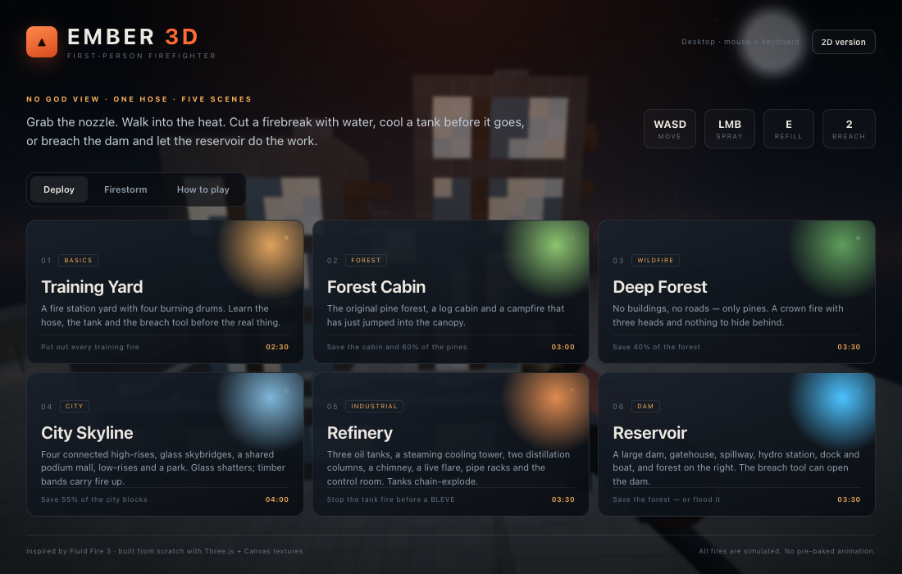
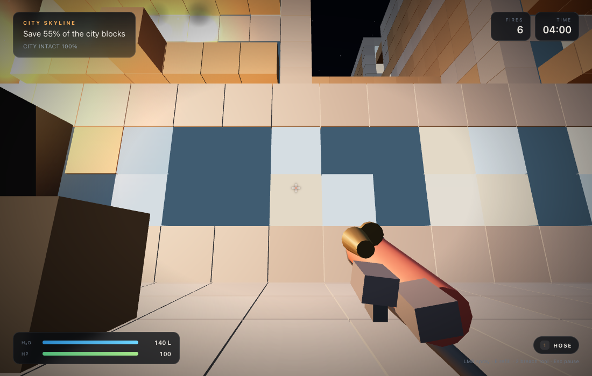
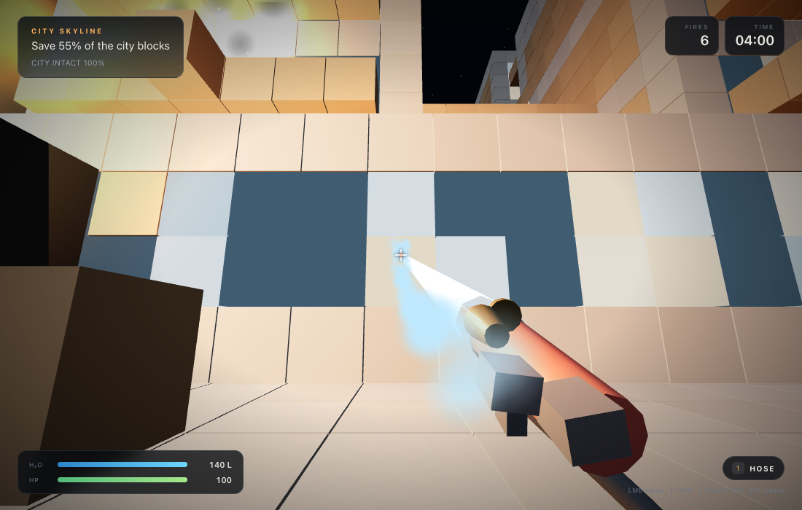
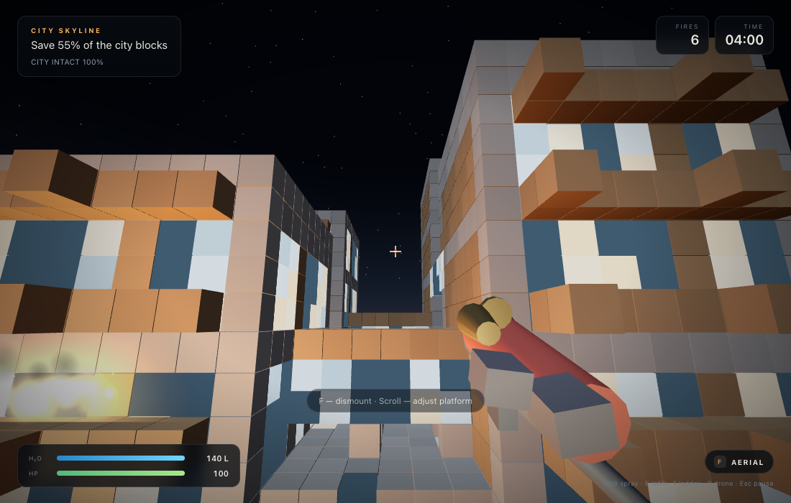
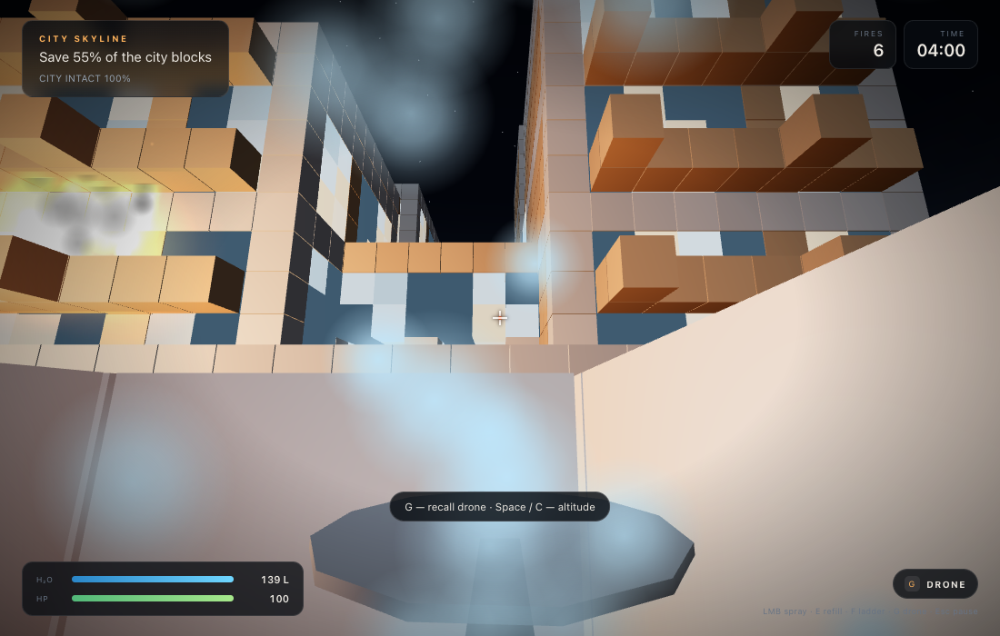

# EMBER · Wildfire Lab

Two ways to play with fire — and put it out.

- **[EMBER 2D](ember-wildfire.html)** — a side-view fluid-fire sandbox: draw wood, stone and water, light it up, fight five missions, or play the four-difficulty Smother challenge.
- **[EMBER 3D](ember-3d.html)** — a first-person firefighter: walk in with a hose, ride the aerial ladder or fly the firefighting drone, cool tanks before they BLEVE, breach the reservoir dam, and fight the six 3D locations.

Both pages are fully English, both link to each other, and both run from the same folder. There is no build step or server needed to play.

**2D → 3D:** the **3D VERSION** button in the 2D header (desktop) or **Play 3D Version** in the right-hand panel; the help dialog also links across.
**3D → 2D:** the **2D version** button in the 3D menu.

## What's new

- **Aerial ladder truck** in every 3D scene — press **F** to ride the bucket, scroll to raise/lower it, and spray from up to 28 m while the truck keeps your tank filled.
- **Firefighting drone** — press **G** to deploy, fly with **WASD** + **Space/C**, spray from the air, and press **G** to recall.
- **Clearer fire and water** — larger additive flames, a pulsing fire glow, stronger fire light, a thick visible water jet, bigger droplets and splashes.
- **Persistent fire sources** — the main fire in each 3D scenario keeps burning until you wet it, so a scene cannot auto-complete when the first flame dies.
- **City fix** — the city has a street-level pallet fire plus a high balcony fire, and a minimum scenario time before a win.
- **One project, two versions** — 2D and 3D are merged, both link to each other, and this is the single README for both.

## Quick start

```bash
open ember-wildfire.html     # 2D
open ember-3d.html           # 3D
```

Chrome or Edge is recommended. The 2D version also works on tablets and phones. The 3D version is desktop-first: it uses pointer lock for mouse look.

## At a glance

| | EMBER 2D | EMBER 3D |
| --- | --- | --- |
| View | Side-on sandbox | First person, eye level |
| You control | 8 drawing tools, wind, rain | A hose, a breach tool, movement, a water tank, an aerial ladder and a drone |
| Fire | 240 × 135 fluid/cellular fire | 96 × 40 × 96 voxel fire and heat |
| Scenes | 6 presets | 6 rebuilt 3D scenes |
| Modes | Sandbox · 5 Missions · Smother | 6 Scenarios · Firestorm |
| Difficulty | 4 Smother levels | 4 Firestorm levels |
| Best for | Drawing, experimenting, free play | Immersion, firefighting, danger |
| Renderer | Canvas 2D, 1×/2×/3× | Three.js WebGL, voxels + particles |

---

# EMBER 2D

A fluid-fire sandbox with six presets, five missions and a wood-smothering challenge.

## 2D scenes

| Preset | What is there |
| --- | --- |
| Blank | A bare valley with a little grass. Build anything. |
| Forest | Pines, grass, a log cabin and a campfire. |
| Deep Forest | A dense pine forest with no buildings. |
| City | Four connected high-rises, glass facades, timber balconies and a small refinery. |
| Refinery | Three oil tanks, a cooling tower, two distillation columns, a chimney and a flare stack. |
| Reservoir | A dam, spillway, hydro plant and forest. Erase the dam to flood the valley. |

## 2D controls

| Input | Action |
| --- | --- |
| Left mouse / touch drag | Paint with the selected tool |
| `1` … `8` | Wood, Pine, Stone, Water, Oil, Ignite, Wind, Erase |
| `[` / `]` | Brush size |
| `Space` | Pause / resume |
| `M` | Mute |
| `R` | Restart |
| `Esc` | Close a dialog |

**Wind** is a drag tool: pull across the canvas to push fire. **Erase** removes materials and is the only way to break the reservoir dam.

## 2D missions

Five hand-built missions unlock in order; stars are based on how much forest or city survives, and progress is saved in `localStorage`.

1. **Cabin Watch** — save the cabin and 60% of the trees.
2. **Firebreak** — cut the grass with stone before the grove burns.
3. **Spot Fires** — two cabins, two oil drums, shifting wind.
4. **Long Night** — three fires, three rains, 150 seconds.
5. **City on Fire** — a high-rise and a refinery, with the reservoir dam as a last resort.

## 2D Smother challenge

The computer keeps igniting fires; you only have wood. Paint wood onto a burning cell or a fire source to smother it instantly; the wet wood resists fire for a while. Wood anywhere else becomes fuel. Clear every fire after the last ignition to win. The four levels tune ignitions, spawn interval, fire limit and time.

## 2D quality

The physics grid is always 240 × 135. The canvas is supersampled and every cell is painted with per-pixel material textures:

| Setting | Render resolution |
| --- | --- |
| Fast | 240 × 135 (1×) |
| Clear | 480 × 270 (2×) — default |
| Ultra | 720 × 405 (3×) |


---

# EMBER 3D

A first-person firefighter built on the same firefighting idea. You are on the ground, in the aerial bucket, or at the drone's camera — no god camera.

## 3D scenes

| Scene | What is in the 3D build |
| --- | --- |
| Training Yard | Fire station, training tower, four burning drums, aerial ladder truck, hydrants |
| Forest Cabin | Pine forest, log cabin with porch and chimney, campfire, path, well |
| Deep Forest | Dense pines only, no buildings, stream-side refill point |
| City Skyline | Four connected high-rises, glass skybridges, shared podium mall, low-rises, park with fountain |
| Refinery | 3 oil tanks, cooling tower with steam, 2 distillation columns, chimney, live flare, pipe racks, control room; tanks overheat and chain-BLEVE |
| Reservoir | Large dam, gatehouse, spillway, hydro station, dock and boat, forest on the right; the dam can be breached and the lake drains into the valley |

Every 3D scene also includes an **aerial ladder truck** and a **firefighting drone**: the ladder is the tall, stable platform, and the drone is the fast flying option.

## 3D controls

| Input | Action |
| --- | --- |
| Mouse | Look |
| `W A S D` | Move · `Shift` sprint · `Space` jump |
| Left mouse | Spray water (hold) |
| `E` | Hold near a hydrant, water point or the reservoir to refill |
| `1` / `2` | Hose / breach tool |
| `F` | Ride / leave the aerial ladder truck |
| Mouse wheel (on ladder) | Raise / lower the aerial platform |
| `G` | Deploy / recall the firefighting drone |
| `Space` / `C` (drone) | Climb / descend |
| `Esc` | Release mouse / pause |
| `R` | Restart the current scenario |
| `M` | Mute |

On foot, **Space** jumps. While flying the drone, **Space** climbs and **C** descends.

## Aerial ladder and drone

Both versions of the high-access kit are in the 3D game:

- **Aerial ladder truck** — parked near the action in every scene. Walk up and press **F**. You ride the bucket up to 18 m (scroll to adjust between 5 m and 28 m), keep the hose, and the truck keeps your tank topped up while you are on the platform. The city spawn is within reach of the truck, so you can press F straight away.
- **Firefighting drone** — press **G** to deploy. Fly with **WASD**, climb/descend with **Space / C**, look with the mouse, and hold the left mouse button to spray from the drone. Press **G** again to recall. The drone uses your water tank; fly it to a hydrant, water point or the reservoir and hold **E** to refill without landing. The drone camera sits just above the frame, with its arms and rotors visible below.

The ladder is the stable high platform for sustained streams; the drone is the fast, flexible option for tower tops and canopy fires.

The **breach tool** is the first-person erase tool. It breaks concrete, stone, wood and metal — including the reservoir dam. Open the dam and the shallow-water simulation floods the valley, dousing ground fires and lowering the lake.

## 3D scenarios

Each scene has an objective, a timer and a failure condition:

- **Training** — put out every training fire.
- **Forest Cabin** — save the cabin and 60% of the pines.
- **Deep Forest** — save 40% of the forest.
- **City Skyline** — save 55% of the city blocks.
- **Refinery** — stop the tank fire before a BLEVE.
- **Reservoir** — save the forest, or flood it.

Fires are persistent **fire sources** until you wet them, so a scenario cannot finish just because the first flame burned out. The city has a street-level pallet fire plus a high balcony fire; look up and use the hose's long reach.

## 3D Firestorm

The city keeps reigniting. An orange beam marks each new ignition; you have one hose and a fire cap.

| Difficulty | Ignitions | Interval | Fire cap | Time |
| --- | ---: | ---: | ---: | ---: |
| Easy | 8 | ~7 s | 500 | 2:30 |
| Medium | 14 | ~5 s | 700 | 3:00 |
| Hard | 22 | ~3.5 s | 900 | 3:30 |
| Hell | 32 | ~2.4 s | 1200 | 4:00 |

## 3D performance

The 3D renderer is heavier than the 2D one. On a normal desktop GPU it runs smoothly; in a headless/software WebGL environment (automated screenshots) it can drop to a few frames per second. If it is slow:

1. Use Chrome directly rather than an embedded preview.
2. Use a smaller window; the renderer caps its pixel ratio at 1.5.
3. The 2D version is much lighter and remains available.











---

# Shared technology

- **Vanilla JavaScript + Canvas 2D** for the 2D version.
- **Three.js r150 + WebGL** for the 3D version.
- Both are single-file builds with no external requests: CSS, JS, Three.js and screenshots are inlined or local.
- The 2D simulation uses a 240 × 135 stable-fluids velocity field, 14 pressure iterations, semi-Lagrangian advection, vorticity confinement, and a cellular material layer for fire, water, glass, oil and steam.
- The 3D simulation uses a 96 × 40 × 96 voxel grid at 2.4 m cells, typed arrays, a 12 Hz fire/heat tick with persistent fire sources, and a 20 Hz shallow-water field for the reservoir. Fire, smoke, water, steam and sparks are GPU point systems.
- The 3D world is a single instanced box mesh with per-instance colours; glass windows are a separate emissive mesh so the city lights up at night.
- The aerial ladder is a scene prop with an adjustable platform; the drone is a free-flying camera and water nozzle that uses the same raycast, water and extinguish code as the hose.

## Project structure

```text
ember/
├── README.md
├── .gitignore
├── ember-wildfire.html      # built 2D single file
├── ember-3d.html            # built 3D single file
├── 2d/                      # 2D source
│   ├── index.html
│   ├── style.css
│   ├── sim.js
│   ├── city.js
│   ├── renderer.js
│   ├── ui.js
│   ├── build.py
│   └── shots/
└── 3d/                      # 3D source
    ├── index.html
    ├── style.css
    ├── world.js
    ├── game.js
    ├── three.min.js
    ├── build.py
    └── shots/
```

## Build

```bash
cd 2d && python3 build.py      # writes ../ember-wildfire.html
cd 3d && python3 build.py      # writes ../ember-3d.html
```

Both build scripts use paths relative to their own folder, so the project can be cloned anywhere and rebuilt.

## Credits

Inspired by **Fluid Fire 3** by [Escape Motions](https://escapermotions.com/) / Peter Blaskovic. This is an independent, from-scratch implementation; no original code or assets are included. Sound effects are synthesized with the Web Audio API. Interface icons are inline SVG or emoji.

## License

The source is provided for personal, non-commercial use. **Fluid Fire 3** and the Escape Motions name are the property of Escape Motions; this project is not affiliated with or endorsed by them.
