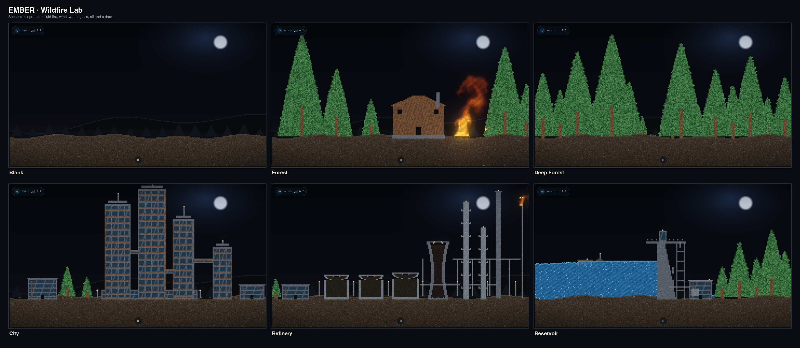
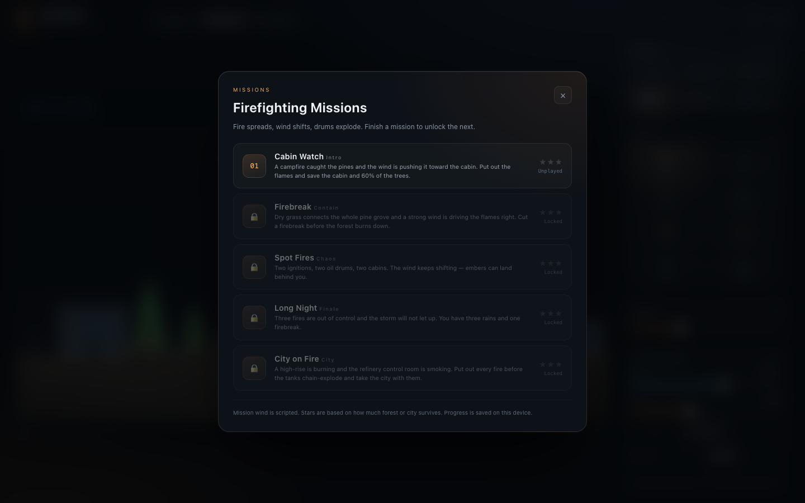
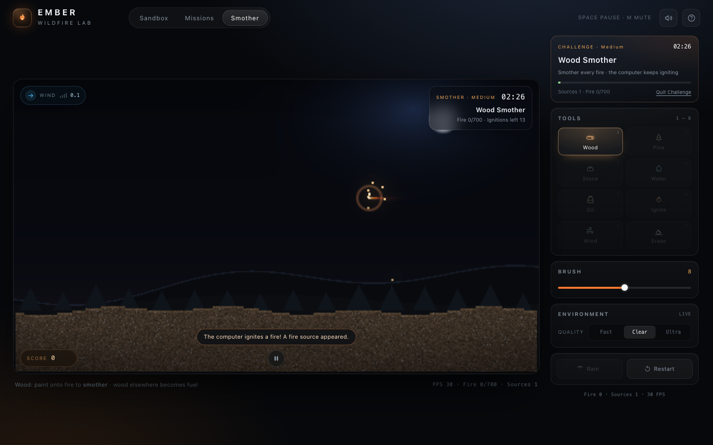

# EMBER · Wildfire Lab

An interactive fluid-fire sandbox that runs entirely in the browser. Paint materials, light them up, and then try to put the fire out — with wind, water, stone firebreaks, a dam, or your bare hands and a lot of wood.

Inspired by [Fluid Fire 3](https://escapermotions.com/) by Escape Motions (Peter Blaskovic). This is a from-scratch, vanilla-JavaScript reinterpretation that turns the toy into a small game you can actually win or lose.



## Quick start

No install, no build step, no network requests:

```bash
open ember-wildfire.html          # macOS
# or just double-click the file, or drag it into Chrome
```

If your browser is picky about `file://` (it usually is not here), serve the folder:

```bash
python3 -m http.server 8000
# open http://localhost:8000/ember-wildfire.html
```

Chrome or Edge is recommended. The game also works on phones and tablets with touch.

## What is in the box

- **Fluid fire** — a 240×135 stable-fluids velocity field drives flames, smoke, heat and embers. Fire climbs, bends with the wind and throws spot fires.
- **Materials that react** — wood, pine, stone, water, oil, ash, char, grass, soil, concrete, glass, metal and lamps all have their own fire/heat behaviour. Glass shatters, oil drums explode, timber floors carry fire up a high-rise, wet fuel resists ignition.
- **6 sandbox presets** — blank canvas, forest cabin, deep forest, connected city towers, a large oil refinery and a dammed reservoir.
- **5 missions** with objectives, stars and saved progress.
- **Smother challenge** — an AI opponent that keeps igniting fires while you cover them with wood, across four difficulties.
- **Three render qualities**, procedural sound, and a responsive desktop/mobile layout.

## Controls

| Input | Action |
| --- | --- |
| Left mouse / touch drag | Paint with the selected tool |
| `1` … `8` | Wood, Pine, Stone, Water, Oil, Ignite, Wind, Erase |
| `[` / `]` | Smaller / larger brush |
| `Space` | Pause / resume |
| `M` | Mute / unmute |
| `R` | Restart the current scene, mission or challenge |
| `Esc` | Close a dialog |

**Wind** is different from the other tools: drag across the canvas to blow the fire in a direction. **Erase** clears materials and is the only way to break the reservoir dam.

## Modes

### Sandbox

Six presets, all fully destructible:

| Preset | What is there |
| --- | --- |
| Blank | A bare valley with a little grass. Build anything. |
| Forest | Pines, grass, a cabin and a campfire. |
| Deep Forest | A dense pine forest with no buildings. |
| City | Four connected high-rise towers, glass facades, timber balconies, a small refinery. |
| Refinery | Three oil tanks, a cooling tower, two distillation columns, a chimney and a flare stack. |
| Reservoir | A dam, spillway, hydro plant and forest. Erase the dam to flood the valley. |

### Missions

Five hand-built missions unlock in order. Stars are based on how much forest or city survives; progress is stored in `localStorage` on the device.

1. **Cabin Watch** — save the cabin and 60% of the trees.
2. **Firebreak** — cut the grass with stone before the whole grove burns.
3. **Spot Fires** — two cabins, two oil drums, shifting wind.
4. **Long Night** — three fires, three rains, 150 seconds.
5. **City on Fire** — a high-rise and a refinery, with the reservoir dam available as a last resort.



### Smother challenge

The third tab is a different game. The computer ignites fires continuously; you only have wood.

- **Paint wood onto a burning cell or a fire source** to smother it instantly. The wood left behind is wet and resists fire for a while.
- **Wood painted anywhere else becomes fuel.** You can build structures, but the AI will happily set them alight.
- Fire sources in the air are marked with a pulsing orange ring. Ignitions are announced on screen.
- The **fire meter** shows how close the fire is to the failure limit. If it overflows, or the timer runs out, you lose.
- The AI has a limited number of ignitions. **Smother every fire after the last ignition to win.**
- Your best score for each difficulty is saved.

| Difficulty | Ignitions | Ignite every | Max live sources | Fire limit | Time |
| --- | ---: | ---: | ---: | ---: | ---: |
| Easy | 8 | ~7 s | 2 | 500 | 2:00 |
| Medium | 14 | ~5 s | 4 | 700 | 2:30 |
| Hard | 22 | ~3.5 s | 6 | 950 | 3:00 |
| Hell | 32 | ~2.4 s | 9 | 1300 | 3:30 |



## Render quality and performance

The physics grid is always **240×135**. The canvas is supersampled and every cell is painted with a per-pixel material texture:

| Setting | Render resolution | Notes |
| --- | --- | --- |
| Fast | 240×135 (1×) | Cheapest; most pixelated |
| Clear | 480×270 (2×) | **Default**; good balance |
| Ultra | 720×405 (3×) | Sharpest; heaviest |

The choice is in **Environment → Quality** and is remembered in `localStorage`.

On a 2021 MacBook Pro in Chrome, the heavy city mission runs at roughly **6–7 ms/frame at 2×** (well above 60 fps) and about 8 ms at 3×. The simulation uses 14 pressure-solver iterations, semi-Lagrangian advection, vorticity confinement and a cellular water/combustion layer.

If you see a locked ~30 fps:

1. Switch the quality to **Fast** and check the FPS counter.
2. Open `ember-wildfire.html` directly in Chrome rather than inside a preview pane or iframe — some embedded previews cap `requestAnimationFrame` at 30 Hz.
3. Close other heavy tabs, or use a smaller browser window.

## How it works

The source lives in [`ember/`](ember/):

```
ember/
├── index.html      # markup and canvas layers
├── style.css       # dark UI, responsive layout
├── sim.js          # fluid + fire + materials simulation
├── city.js         # scene builders (city, refinery, reservoir, forest, blank)
├── renderer.js     # Canvas2D supersampled renderer, textures, glow, embers
├── ui.js           # state, tools, missions, smother AI, audio, game loop
├── build.py        # inlines CSS + JS into the single-file deliverable
└── shots/          # screenshots
```

### Simulation

`sim.js` keeps all state in typed arrays over a 240×135 grid:

- **Velocity** — semi-Lagrangian advection, buoyancy, vorticity confinement and a 14-iteration pressure projection. Solid cells are excluded from the velocity solve so plumes can rise out of a fire.
- **Scalars** — temperature, smoke and flame are advected and diffused, then coupled back into the velocity field.
- **Materials** — a cellular layer for wood, pine, stone, water, oil, ash, char, grass, soil, concrete, glass, metal and lamps. Each has fuel, heat resistance, conductivity and flammability.
- **Combustion** — preheating, ignition, burn-down to char, embers, smoke and explosions.
- **Water** — a cellular automaton with flow, soaking and evaporation; hot water becomes steam.
- **Glass** — heated glass shatters into shards and can cut through the building.
- **Fire sources** — used by Smother mode; an air cell that keeps burning until covered.
- **Smother painting** — when the wood tool is used in Smother mode, painting a burning cell extinguishes it and creates wet wood.

### Rendering

`renderer.js` writes into an offscreen `ImageData` at 1×/2×/3×, then composites a low-resolution bloom, embers and fire-source rings. Materials get high-resolution procedural textures (wood grain, pine needles, glass reflections, stone speckle), which is what keeps the upscaled cells from looking like a plain pixel grid.

`build.py` reads `index.html`, inlines `style.css` and all four JS files, and writes `../ember-wildfire.html`. Run it from `ember/`:

```bash
python3 build.py
```

The output is a single self-contained HTML file with no external fonts, images or scripts.

## Browser support

Modern Chrome, Edge, Safari and Firefox. Requires Canvas 2D and (for sound) Web Audio. Touch painting works on mobile; the layout collapses to a single column. No server is required.

## Credits

- Original concept and inspiration: **Fluid Fire 3** by [Escape Motions](https://escapermotions.com/) / Peter Blaskovic.
- This implementation, code and scene art: built from scratch with vanilla JavaScript and Canvas 2D. No code or assets from the original are included.
- Sound effects are synthesized at runtime with the Web Audio API.
- Interface icons are inline SVG or emoji.

## Notes and limitations

- The physics grid is 240×135. The render is supersampled (up to 3×), but it is not a higher-resolution simulation; very fine channels and filaments are below the grid scale.
- Mission wind is scripted; sandbox wind can be dragged freely.
- The game is tuned for a desktop mouse. Touch works, but the Smother mode is harder on a phone.
- This is a personal fan project, provided as-is for learning and personal use.

## License

The MIT Licence. **Fluid Fire 3** and the Escape Motions name are the property of Escape Motions; this project is not affiliated with or endorsed by them.
